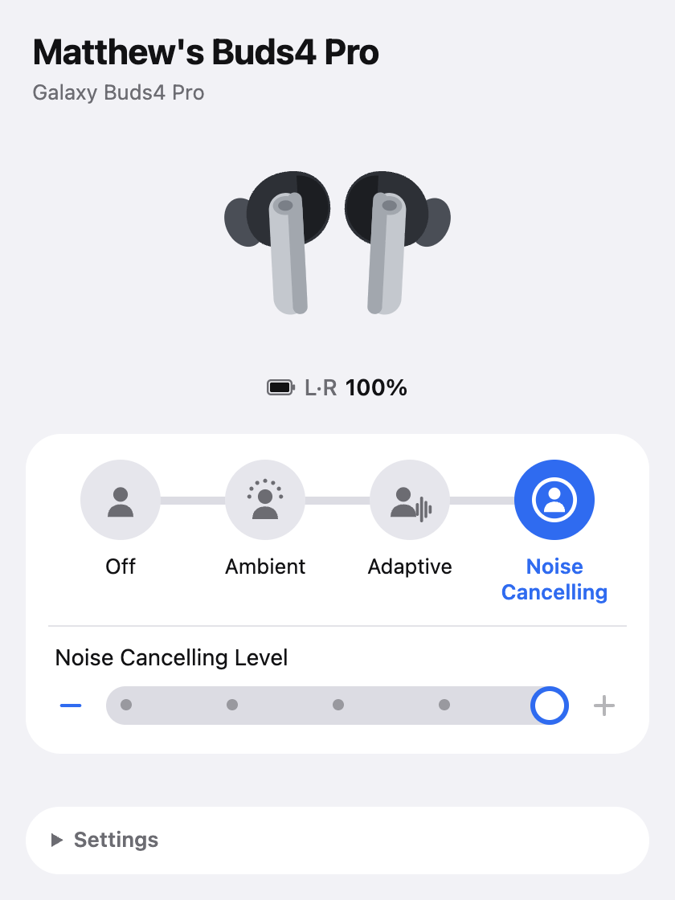
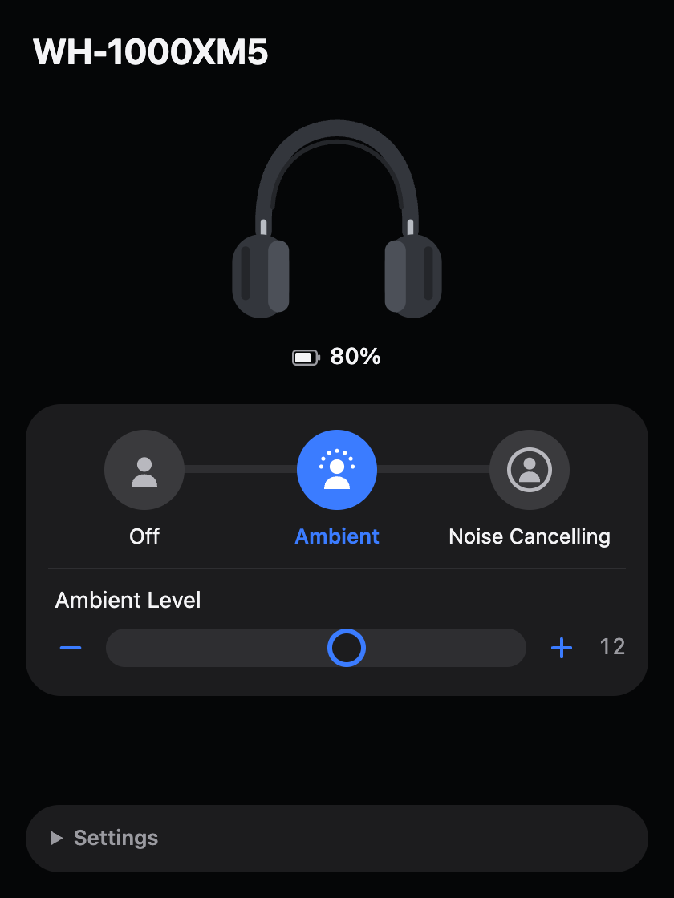
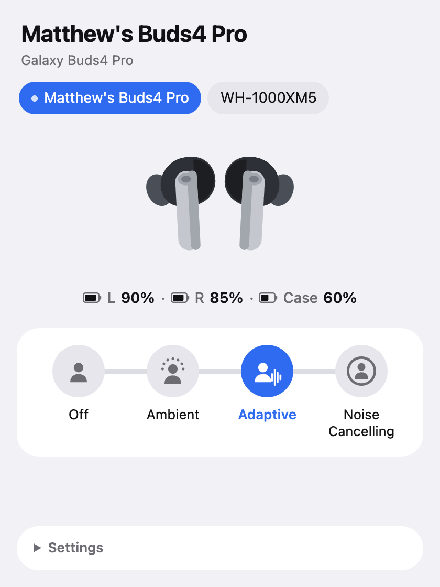

# Headphone Bridge

An app for desktop (macOS and Linux) and Android that changes the Noise
Control Mode and Ambient Level of a Galaxy Buds4 Pro or WH-1000XM5, and shows
their Status.
Vocabulary follows [GLOSSARY.md](GLOSSARY.md); decisions are in
[docs/adr](docs/adr).

<p align="center">
  
  
  
</p>

## Layout

- `crates/core`: the platform-independent core. Its public API (`Core`) takes
  commands and emits Device list snapshots; everything OS-specific comes in
  through the platform port (`platform::Platform`). Tests drive it through a
  scripted fake platform in `crates/core/tests/support`.
- `crates/platform-macos`: the macOS platform adapter (IOBluetooth). It
  compiles to nothing on other OSes and is tested by hand.
- `crates/platform-linux`: the Linux platform adapter (BlueZ through `bluer`,
  and the PulseAudio/PipeWire default sink). Its pure mappings build and are
  tested on every OS; the rest compiles only on Linux and is tested by hand.
- `crates/platform-android`: the Android platform adapter. Its Kotlin side
  (`android/`) owns Bluetooth and talks JSON to the core over JNI; the
  message mapping and the core's host build and are tested on every OS, and
  the rest is tested by hand.
- `app/src-tauri`: the Tauri v2 shell. `app/src-tauri/gen/android` is the
  generated Android project, committed.
- `app/src`: the React + TypeScript UI.

## Development

Requires Rust (stable) and Node 22.

```sh
cargo test --workspace --exclude headphone-bridge   # core tests, as CI runs them
cd app && npm install
```

### Running on macOS

macOS grants Bluetooth access only to a signed `.app` whose Info.plist has
`NSBluetoothAlwaysUsageDescription`, so a bare `cargo run` or `npm run tauri dev`
starts but can never open a control link. Run development builds through the
bundle instead:

```sh
cd app
npm run open:dev
```

This builds a debug, ad-hoc signed `Headphone Bridge.app` at
`target/debug/bundle/macos/` and opens it. Use `npm run bundle:dev` to build
without opening. `npm run tauri dev` is still fine for UI-only work.

### Running on Linux

Needs no root or group membership: BlueZ opens the control link and hands it
over D-Bus. Install the build dependencies (Ubuntu 24.04):

```sh
sudo apt install libwebkit2gtk-4.1-dev libayatana-appindicator3-dev librsvg2-dev \
  libxdo-dev libssl-dev libdbus-1-dev libpulse-dev pkg-config file
```

Then `cd app && npm run tauri dev` runs the app, and
`npm run tauri build -- --bundles deb,appimage` builds the deb and AppImage
under `target/release/bundle/`. On GNOME the tray needs the AppIndicator
extension, which Ubuntu enables by default.

### Running on Android

The Android app needs Android 12 or later, and asks for the Nearby devices
permission on first launch. If it's refused, the app screen says why it's
needed, with a button to the app's Android settings; once it's granted there,
Devices show without a restart. It Attaches Devices only while the app screen is
in the foreground, and Detaches them 3 s after it leaves, so the vendor apps
can have the control link. Building it needs the Android SDK and NDK
(`ANDROID_HOME`, `NDK_HOME`), a JDK (`JAVA_HOME`), and the Rust target
`aarch64-linux-android`:

```sh
cd app && npx tauri android build --debug --apk --target aarch64
adb install -r src-tauri/gen/android/app/build/outputs/apk/universal/debug/app-universal-debug.apk
adb logcat -s HeadphoneBridge   # the app's lines; Rust's, panics included, start with [rust]
```

`adb install` needs USB debugging on the phone (Settings → System →
Developer options). To install a released APK without adb, open it on the
phone and allow installs from that app when Android asks. A debug build and
a released build are signed with different keys, so uninstall one before
installing the other.

To read the app's logs (Kotlin, the WebView's console and Rust) with the
phone connected:

```sh
adb logcat --pid="$(adb shell pidof -s dev.matthewbpt.headphonebridge)"
```

Start the app first: `pidof` finds nothing while it isn't running.

A release build (`npx tauri android build --apk --target aarch64`) comes out
unsigned unless `src-tauri/gen/android/app/keystore.properties` names a
signing key; see [Releasing](#releasing).

### Frame log

The Developer section of the window switches on the frame log, which appends
every frame sent to or received from a Device to `frame-log.frames` in the
app's log directory, in the test fixture format. The setting stays on across
launches, so Devices already Connected at startup have their Attach logged.
Setting `HEADPHONE_BRIDGE_FRAME_LOG` (to anything) also starts the app with it
on, e.g. `HEADPHONE_BRIDGE_FRAME_LOG=1 "target/debug/bundle/macos/Headphone
Bridge.app/Contents/MacOS/headphone-bridge"`.

On Android the file is in app-private storage, so the Developer section has
**Share frame log** instead: it hands a copy of the file to the share sheet, to
save to Files or send from the phone. When the widget or tile starts the app's
process, nothing is logged until the app screen opens.

### Screenshots

The screenshots at the top are the window against the fake core the UI tests use,
not a real Device. `cd app && npm run screenshots` captures them again into
`docs/screenshots/` (it needs Google Chrome; set `CHROME` to its binary if
it isn't in `/Applications`). The scenes are in
`app/src/testing/screenshots.tsx`.

## Releasing

Desktop and Android share one version, `version` in
`app/src-tauri/tauri.conf.json`. To release, bump it, merge, then push a tag
`v` + that version (e.g. `v0.2.0`). The `Release` workflow checks the tag
matches, builds the macOS dmg, the Linux deb and AppImage and a signed
Android APK, and attaches them all to the tag's GitHub Release. The release
notes are `.github/release-notes.md` followed by the generated list of
changes; remove the "Upgrading the desktop app" section after the release
that changes the identifier.

The Android version name is the version, and the version code is
major × 1,000,000 + minor × 1,000 + patch, so each release's code is
higher than the last as long as the version goes up.

### The Android signing key

The keystore exists only in the repository's Actions secrets. Android
refuses to update an installed app signed with a different key, so keep a
backup of the keystore and its passwords somewhere private: losing it means
listeners have to uninstall to upgrade. Create it once, outside the repo:

```sh
keytool -genkeypair -v -keystore headphone-bridge-release.jks -storetype JKS \
  -keyalg RSA -keysize 4096 -validity 10000 -alias headphone-bridge
```

Then add these secrets (Settings → Secrets and variables → Actions), e.g.
with `gh secret set`:

| Secret | Value |
| --- | --- |
| `ANDROID_KEYSTORE_BASE64` | `base64 -i headphone-bridge-release.jks` (macOS) or `base64 -w0 headphone-bridge-release.jks` (Linux) |
| `ANDROID_KEYSTORE_PASSWORD` | the keystore password |
| `ANDROID_KEY_ALIAS` | `headphone-bridge` |
| `ANDROID_KEY_PASSWORD` | the key password (the same as the keystore password unless you chose another) |

Don't use backslashes in the passwords: the workflow writes them into a Java
properties file. To sign a release build locally, write the same values to
`app/src-tauri/gen/android/app/keystore.properties` (gitignored):

```properties
storeFile=/absolute/path/to/headphone-bridge-release.jks
storePassword=…
keyAlias=headphone-bridge
keyPassword=…
```

`app/scripts/check-apk.sh <apk> <version>` checks that an APK is
release-signed and has the given version name, as the workflow does
before attaching it.

## Licence

Dual-licensed under [MIT](LICENSE-MIT) or [Apache-2.0](LICENSE-APACHE), at your
option. See [NOTICE](NOTICE) for the projects this one ports from.
